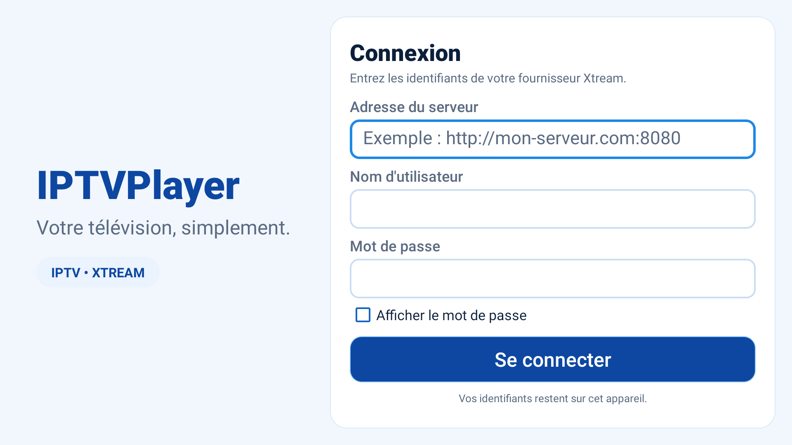
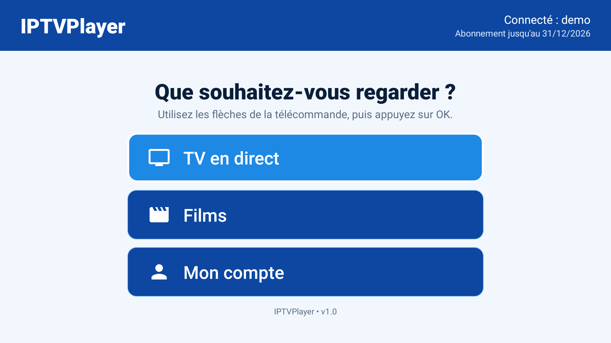
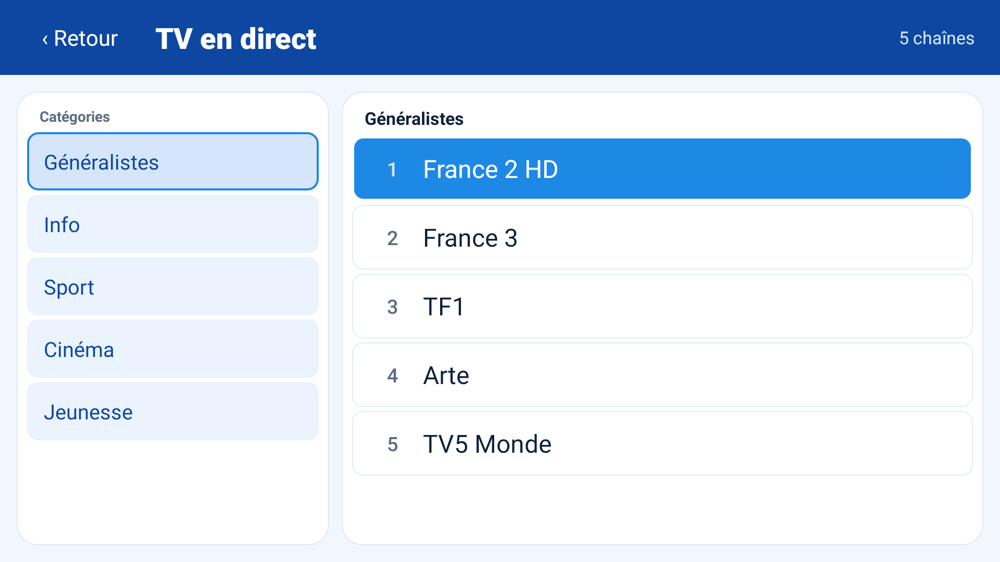
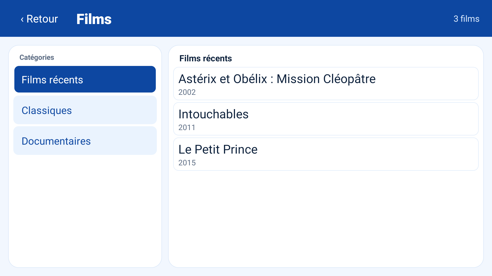
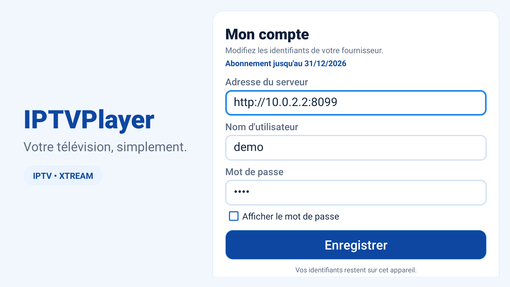
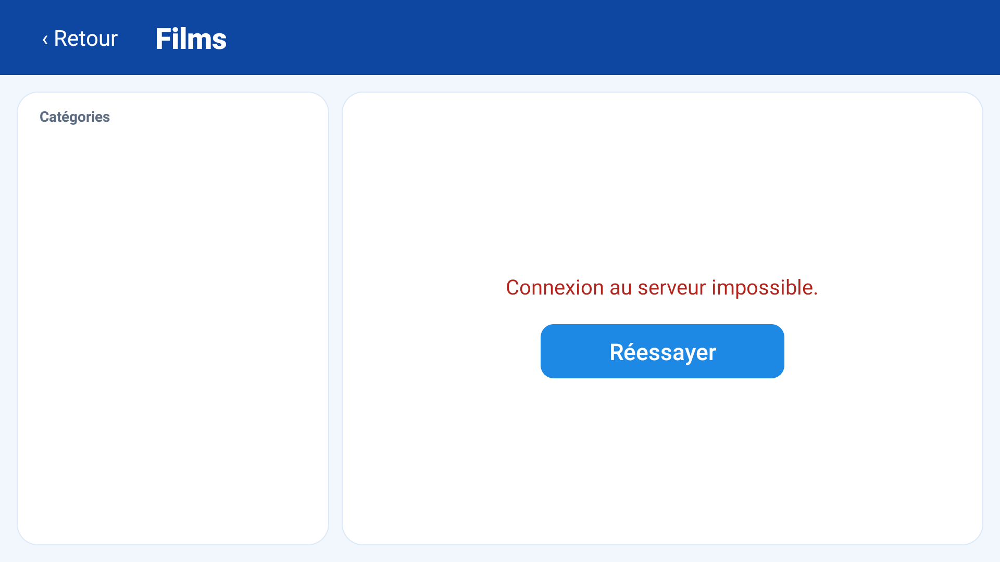

# IPTVPlayer

Lecteur IPTV Android TV pour abonnement **Xtream**, pensé pour être utilisé par une
personne âgée : grands caractères, contrastes forts, thème bleu et navigation
uniquement à la croix directionnelle de la télécommande.



## Fonctionnalités

- Connexion Xtream avec l'adresse du serveur, le nom d'utilisateur et le mot de passe.
- Affichage de la **date d'expiration de l'abonnement** sur l'accueil et dans « Mon compte ».
  La date vient du champ `exp_date` renvoyé par le serveur ; si elle est dépassée,
  elle s'affiche en rouge.
- **TV en direct** : catégories, chaînes triées par numéro, lecture HLS avec repli
  automatique vers le flux MPEG-TS si le HLS échoue.
- **Films** : catégories et lecture de la fiche VOD avec son extension réelle
  (`mp4`, `mkv`, etc.).
- Écran d'accueil à trois gros boutons : TV en direct, Films, Mon compte.
- Gestion des erreurs : message lisible et bouton « Réessayer » sur les listes
  comme sur le lecteur.
- Identifiants mémorisés localement pour ne pas les retaper au démarrage.

| Accueil | TV en direct | Films |
| --- | --- | --- |
|  |  |  |

| Lecture directe | Fiche compte | Erreur réseau |
| --- | --- | --- |
|  |  |  |

## Prérequis

- JDK 17.
- Android SDK avec la plateforme **API 34** et les build-tools installés.
- Un appareil ou émulateur **Android TV**. L'application démarre aussi sur un
  téléphone Android (minSdk 21), mais l'interface est prévue pour un écran TV.

Le chemin du SDK est lu depuis `local.properties` (`sdk.dir=...`) ou la variable
`ANDROID_HOME`.

## Compilation et installation

```bash
./gradlew assembleDebug
adb install -r app/build/outputs/apk/debug/app-debug.apk
```

L'APK de debug fait environ **4,1 Mo**. Le paquet installé est
`com.iptvplayer`.

Pour lancer les vérifications :

```bash
./gradlew testDebugUnitTest   # 14 tests JVM
./gradlew lintDebug           # aucun avertissement bloquant
```

## Serveur de test local

Un faux panneau Xtream en Python (bibliothèque standard uniquement) permet de
tester l'application sans abonnement réel :

```bash
python3 mock/server.py --port 8099
```

- Identifiants : `demo` / `demo`
- Depuis l'émulateur Android : `http://10.0.2.2:8099`
- Depuis un autre appareil du réseau : `http://<ip-de-la-machine>:8099`
- Date d'expiration simulée : **31/12/2026**

Le serveur sert 5 catégories de direct, 17 chaînes, 3 catégories de films et
8 films. Les flux sont de vrais fichiers HLS/MP4 générés localement dans
`mock/media/` (mire vidéo + son), donc la lecture est réelle.

Pour tester le repli MPEG-TS, désactiver le HLS :

```bash
MOCK_HLS=0 python3 mock/server.py --port 8099
```

Le HLS renvoie alors une erreur 404 et l'application bascule sur le flux `.ts`.

## Émulateur Android TV

Le script `example/emulator.sh` crée si besoin l'AVD **IPTVPlayer**
(image `android-tv;x86`, API 28, définition 1080p) puis attend la fin du boot :

```bash
./example/emulator.sh
```

Variables utiles : `AVD_NAME` pour changer de nom d'AVD, `EMU_GPU` pour changer
de rendu graphique.

## Captures d'écran

Les captures de `docs/screens/` ont toutes été prises sur l'émulateur
Android TV API 28, avec le serveur de test :

```bash
adb exec-out screencap -p > docs/screens/02-home.png
```

Elles couvrent : connexion, accueil avec expiration, direct, changement de
catégorie, lecture directe, compte, films, lecture d'un film, erreur de liste
et erreur du lecteur.

## Parcours testé

Test de bout en bout effectué sur l'émulateur Android TV API 28 (1920 × 1080) :

1. Premier lancement → écran de connexion.
2. Saisie de `http://10.0.2.2:8099`, `demo`, `demo` → accueil.
3. Vérification de la ligne « Abonnement jusqu'au 31/12/2026 ».
4. Navigation aux flèches entre les champs, les catégories, les chaînes et les films.
5. Lecture d'une chaîne en HLS, puis d'un film en MP4.
6. Serveur coupé → message d'erreur et bouton « Réessayer » ; serveur relancé →
   récupération sans quitter l'écran.
7. Serveur lancé avec `MOCK_HLS=0` → lecture du direct via le flux MPEG-TS.
8. Coupure du serveur puis lancement d'un film → écran « Lecture impossible »
   avec « Réessayer » et « Retour à la liste » ; serveur relancé → la lecture démarre.
9. Présence de l'application dans le lanceur TV (bannière et catégorie Leanback).
10. Démarrage à froid mesuré à **928 ms** sur l'émulateur.

## Choix techniques

- **Kotlin + vues Android natives**, sans Compose : moins de dépendances, build
  rapide et comportement simple sur les anciens boîtiers TV.
- **Media3 / ExoPlayer 1.4.1** pour la lecture HLS et MP4.
- **RecyclerView** pour les listes ; pas de bibliothèque de chargement d'images,
  les logos de chaînes ne sont pas affichés.
- Requêtes HTTP avec `HttpURLConnection`, sans client tiers.
- Analyse JSON avec `org.json`, testable sur la JVM.
- `FormEditText` : un champ de saisie qui laisse les flèches haut/bas changer de
  champ, sinon la télécommande reste bloquée dans le formulaire.
- Couleurs et tailles centralisées dans `colors.xml`, `themes.xml` et les styles
  `AppButton`, `AppField`, `AppLabel`.

## Structure

```text
app/src/main/java/com/iptvplayer/
├── data/      Prefs, client HTTP, URLs et analyse Xtream
├── model/     Account, Category, Channel, Movie
├── ui/        Setup, Home, Browse, Player et adaptateurs
└── util/      Expiry, exécution réseau hors thread principal
app/src/test/  tests JVM des URLs et du parseur
mock/          faux serveur Xtream et médias de test
docs/screens/  captures d'écran
example/       script de lancement de l'émulateur
```

## Sécurité et limites

- Les identifiants sont stockés dans les `SharedPreferences` privées de
  l'application, **en clair**. La sauvegarde Android est désactivée
  (`allowBackup="false"`) pour éviter leur copie automatique, mais un appareil
  rooté peut les lire.
- Le trafic HTTP en clair est autorisé (`usesCleartextTraffic="true"`) car
  beaucoup de panneaux Xtream sont en HTTP. HTTPS fonctionne aussi.
- L'application ne gère pas encore : séries, EPG, favoris, enregistrement,
  catch-up, logos de chaînes, plusieurs profils.
- Testée uniquement sur un émulateur Android TV API 28 x86, pas sur un boîtier
  physique. Le rendu et les performances peuvent varier sur un vrai téléviseur.
- L'application ne fait aucun autre appel réseau que ceux du serveur Xtream
  configuré.

## Journal de développement

- **Mise en place** : projet Android TV, thème bleu, écrans Connexion / Accueil /
  Direct / Films / Lecteur, client Xtream et parseur JSON.
- **Expiration** : lecture de `exp_date`, stockage local et affichage sur
  l'accueil et dans « Mon compte », avec passage en rouge si expiré.
- **Ergonomie** : gros boutons, focus très visible, textes agrandis, navigation
  télécommande corrigée dans les champs de saisie.
- **Robustesse** : délais réseau, messages d'erreur explicites, bouton
  « Réessayer », repli HLS → MPEG-TS.
- **Tests** : 14 tests unitaires (URLs et parseur), lint sans erreur, parcours
  complet sur émulateur avec un faux serveur et de vrais flux vidéo.
- **Renommage** : l'application s'appelle désormais **IPTVPlayer** (paquet
  `com.iptvplayer`), avec nouvelle bannière, icône et captures d'écran.
